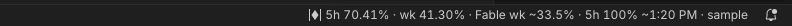
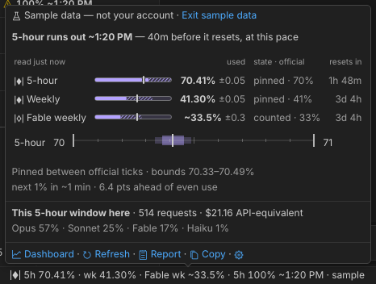
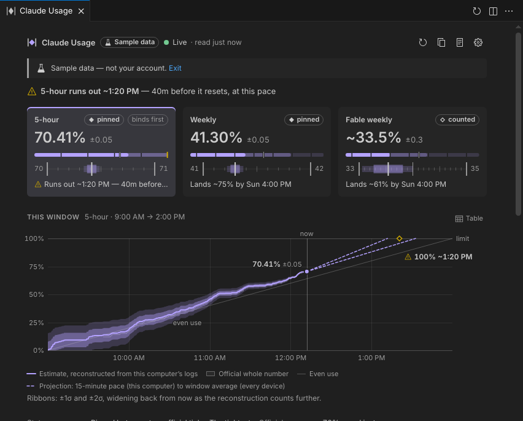
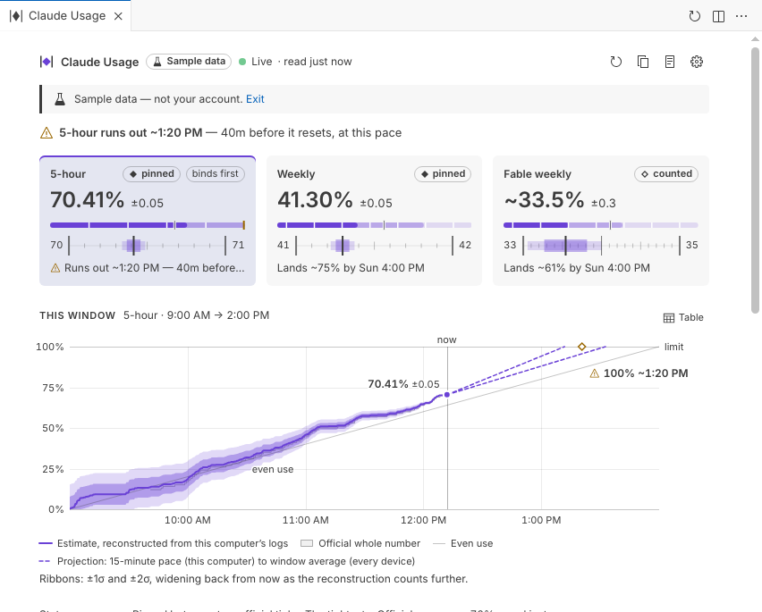
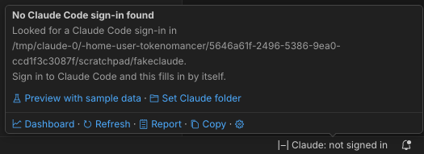

<p align="center"></p>

<h1 align="center">Tokenomancer</h1>
<p align="center"><em>Reads the runes between the whole numbers.</em></p>

Claude's usage meters move in whole percentages. Tokenomancer reads between them. It shows your 5-hour, weekly and per-model limits to the hundredth of a percent, each with an honest ± and a plain statement of how well it's pinned. It's built for Claude Code in VS Code, where the terminal status line doesn't show.





## Features

| | |
|---|---|
| **Hundredths with a ±** | Each limit is estimated between Anthropic's whole-number readings. Tokenomancer shows only the digits its uncertainty supports, such as `46.4%` rather than `46.39%` when the ± is 0.2. |
| **Pinned, counted, loose or calibrating** | A rune and a word say how settled each number is. None of these states relies on colour alone. |
| **Pace and run-out time** | "5-hour runs out ~14:20 — 40m before it resets." The countdown to the next 1% comes from your own pace. |
| **The limit that binds first** | The hover and dashboard rank your limits, so you can see which one will stop you. |
| **A dashboard** | Shows the whole window with a projection, a close-up of the estimate tightening at each official tick, and where your points went by model and token type. |
| **Light and local** | No runtime dependencies. Logs are read incrementally. All VS Code windows share one poll. The webview has a strict CSP and loads nothing from a CDN. |



## Reading the runes

| Status bar | Meaning |
|---|---|
| `◆ 5h 46.39%` | **Pinned** between two official ticks. This is the tightest reading. |
| `~38.4%` | **Counted** from the start of the window using your local logs. It tightens at the next tick. |
| `23.1–24.5%` | **Loose**. Usage outside this computer moved the number, so only the proven range is shown. |
| `16–17%` | **Calibrating**. Tokenomancer is learning what 1% costs; decimals appear after two ticks. |
| `≥61.1% · 12m ago` | **Last known**. The official numbers haven't updated, and usage since then can only add. |

Hover over the item for every limit: meters with the elapsed share of each window, a magnified scale between the whole numbers, pace, reset times and this window's tokens. Click it for the dashboard. You can also run **Usage at a Glance** (Ctrl+Shift+P) for a quick picker.



## How it works

1. **Official numbers.** Tokenomancer reads the same usage endpoint Claude Code's `/usage` uses (`api.anthropic.com/api/oauth/usage`). It authenticates with the Claude Code login on this computer (`~/.claude/.credentials.json`; the Keychain on macOS). All your VS Code windows share one reading, and rate limits are backed off together.
2. **Your tokens.** It tails Claude Code's logs in `~/.claude/projects/**/*.jsonl` and weighs each request's input, output, cache-write and cache-read tokens by API prices.
3. **Calibrate.** Between two ticks of the official number, the requests logged locally cost exactly one point. From many such intervals it learns what 1% costs, plus a correction for each model and token type.
4. **Bound and estimate.** Every official reading bounds where you are now. The estimate is the window's predicted count, kept inside those bounds, and its ± is shown everywhere.

Per-model limits, such as Fable, count only that model's tokens.

### How accurate

Measured in simulation (`npm test`) after calibration, at 60-second polling:

| Scenario | Average error |
|---|---|
| The limit weighs tokens like API prices | ±0.012 points |
| The limit weighs tokens differently (learned) | ±0.03 |
| 300 s polling | ±0.05 |
| The official whole number alone | ±0.23 |

In very heavy use, for example 25% of a 5-hour window per hour, the ± is larger, typically 0.1–0.25. Tokenomancer shows it and drops a decimal when it can't back one.

**Limits of the estimate:**
- Only this computer's logs are visible. When the Claude app, claude.ai or another machine moves the number, Tokenomancer shows the limit as loose and leaves that interval out of calibration.
- The weekly limits tick slowly, so they take a day or two of normal use to settle.

## Privacy

Your sign-in token is sent only to `api.anthropic.com`. It is never logged, saved or shown. Your logs never leave your computer. There is no telemetry.



## Commands

All commands are under **Tokenomancer** in the Command Palette.

| Command | |
|---|---|
| Open Dashboard | The full view: cards, window chart, between-the-whole-numbers chart, where it went, calibration |
| Usage at a Glance | Every limit in a quick picker |
| Refresh Now | Read the official numbers now (throttled to once every 10 s) |
| Open Full Report | A read-only Markdown report with diagnostics, including the raw endpoint response |
| Copy Usage Summary | One line for chat or notes |
| Preview with Sample Data | See every surface before calibrating, or without Claude Code |
| Reset Calibration… | Forget what 1% costs and start again |

The **Claude Usage** view in the Explorer shows a compact dashboard. You can drag it to the panel or to the secondary side bar.

## Settings

| Setting | Default | |
|---|---|---|
| `tokenomancer.statusBar.show` | `all` | `all` limits, the `binding` one, a `pair`, or `custom` |
| `tokenomancer.statusBarBuckets` | `[]` | The keys for `custom`, e.g. `five_hour`, `seven_day_fable` |
| `tokenomancer.statusBar.uncertainty` | `off` | Show the ± in the status bar for the `first` limit or `every` limit |
| `tokenomancer.statusBar.icon` | `rune` | `rune`, `codicon` or `none` |
| `tokenomancer.statusBar.highlight` | `nearLimit` | When the item gets a warning or error background |
| `tokenomancer.statusBar.clickAction` | `dashboard` | `dashboard`, `glance`, `report` or `refresh` |
| `tokenomancer.statusBar.alignment` / `.priority` | `right` / `100` | Where the item sits |
| `tokenomancer.decimals` | `2` | The most decimals ever shown (0–3) |
| `tokenomancer.precision` | `adaptive` | `adaptive` shows only the digits the ± supports; `fixed` always shows `decimals` |
| `tokenomancer.hover.graphics` | `images` | `images`, `text` or `off` |
| `tokenomancer.alerts.mode` | `runOut` | A notification before a limit runs out; `runOutAndLimit` or `off` |
| `tokenomancer.alerts.leadMinutes` | `30` | How early the run-out alert appears |
| `tokenomancer.timeFormat` | `system` | `system`, `12h` or `24h` |
| `tokenomancer.pollSeconds` | `60` | How often to read the official numbers (30–240). Faster gives tighter decimals |
| `tokenomancer.officialRounding` | `floor` | Whether the official whole number is truncated or rounded |
| `tokenomancer.claudeDir` | `""` | Claude Code's folder, if not `~/.claude` |
| `tokenomancer.priceOverrides` | `{}` | Starting weights per model |

You can recolour the accent with `workbench.colorCustomizations`: `tokenomancer.accent`, `tokenomancer.warning` and `tokenomancer.critical`.

## Install

From a release: Extensions view → `…` menu → **Install from VSIX…** → pick `tokenomancer-0.2.0.vsix`.

From source (Node 20+):

```
npm install
npm run package
code --install-extension tokenomancer-0.2.0.vsix
```

## Development

```
npm run typecheck   # TypeScript
npm test            # unit tests, including the estimator simulation
npm run build       # dist/extension.js and media/view.js
```

Set `TOKENOMANCER_DEMO=1` (and optionally `TOKENOMANCER_DEMO_NOW=<ISO time>`) to start in sample-data mode.

**Source layout:**
- `estimator.ts`: calibration and bounds.
- `logReader.ts`, `ledger.ts`: log tailing.
- `poller.ts`: the shared, rate-limit-aware polling.
- `model.ts`: the live model.
- `ui/`: the view model, status bar, hover, glance, report and alerts.
- `webview/`: the dashboard.

Independent project; not affiliated with Anthropic.
